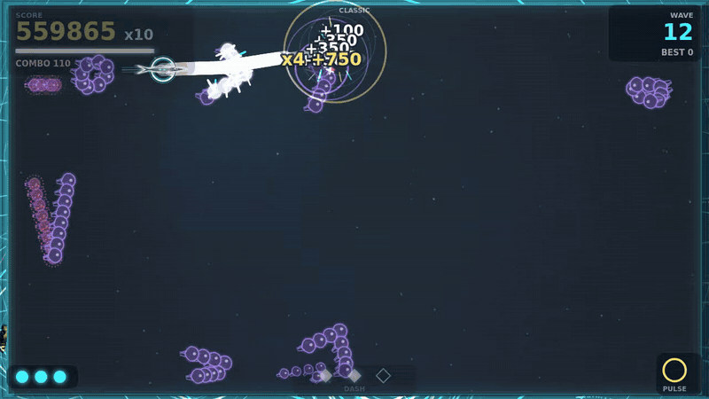
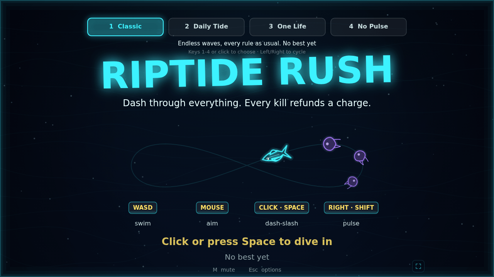
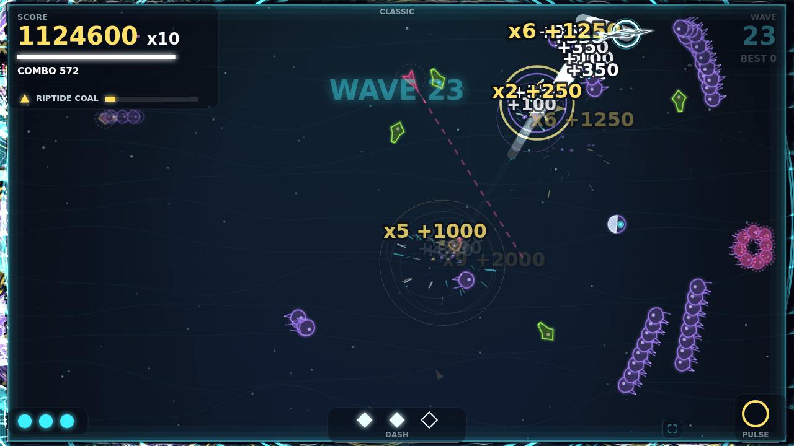
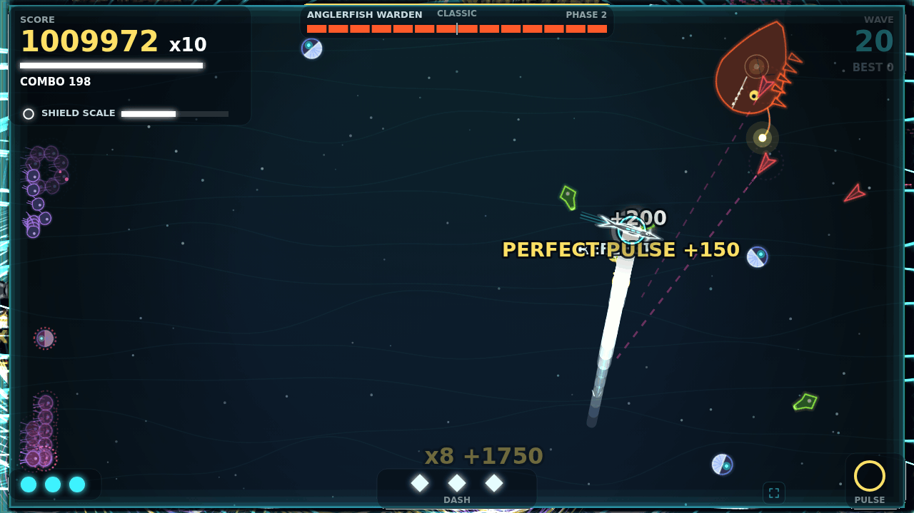
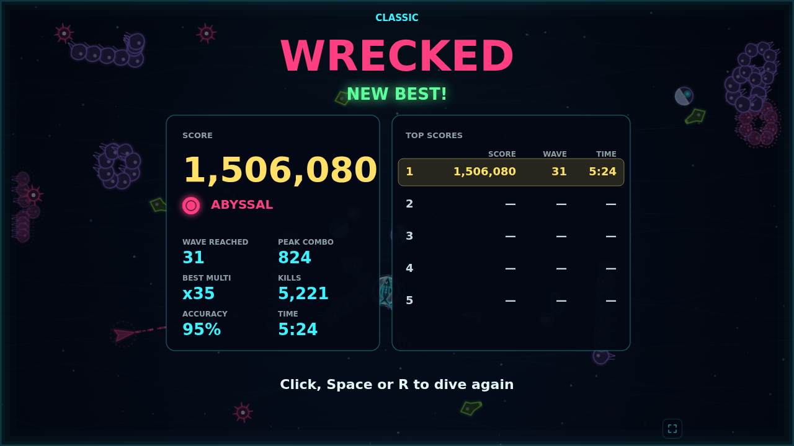
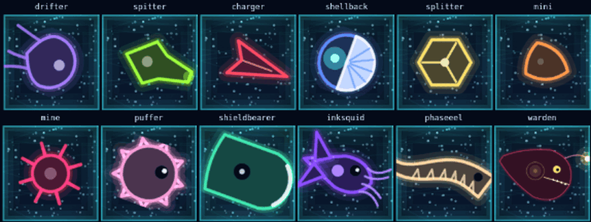

<div align="center">

# Riptide Rush

**You are a blade-fish. You don't shoot. You dash through everything.**

### [▶ Play now in your browser](https://omkarbhale.github.io/riptide-rush/)

[](https://omkarbhale.github.io/riptide-rush/)
[](https://github.com/omkarbhale/riptide-rush/actions/workflows/ci.yml)

<a href="https://omkarbhale.github.io/riptide-rush/"></a>

<sub>Real gameplay from the current build, waves 12 and 13. Free, no install, runs on desktop, phone and gamepad.</sub>

</div>

<br>

## Why it's fun

- **One verb.** Dash-slash through enemies to kill them. You are invulnerable while you dash.
- **Every kill refunds a dash.** Line up the next target and you never run dry.
- **Chain forever.** Kills build a combo, the combo builds a multiplier up to x10, and one dash through a school is a multi-kill bonus.
- **Learn at your own pace.** A new player can swim, wait and line things up. An expert never stops moving. Same rules.

<br>

<p align="center">
  
  
</p>
<p align="center">
  
  
</p>
<p align="center"><sub>Title and mode picker · a crowded late wave · the Anglerfish Warden and a perfect pulse · the run summary (this run was played by the project's test bot)</sub></p>

<br>

## Controls

| Action | Keyboard and mouse | Touch | Gamepad |
| --- | --- | --- | --- |
| Swim | WASD or arrow keys | Left thumb: floating stick | Left stick |
| Aim | Mouse | Right thumb: drag | Right stick |
| **Dash-slash** | Left click or Space | Release the right thumb (a quick tap dashes along the last aim) | A or right trigger |
| **Pulse** | Right click or Shift | PULSE button | B or left trigger |
| Pause and options | Esc or P | Pause button | Start |
| Restart | Space, Enter or R | Tap | A |
| Fullscreen | F | Corner button | |

**Dash:** 3 charges, each recharges in 0.9 s, and every kill gives one back at once.
**Pulse:** a short shockwave that reflects bullets and staggers nearby enemies, on a 2.5 s cooldown.
Reflect a bullet in the last 0.12 s before it hits you for a **perfect pulse**: slow motion, +150 and an instant cooldown reset.
Presses are buffered for 120 ms, so an early click still fires.

The pause screen has volume, mute, screen shake, reduced flashes and a how-to-play replay.

## Modes

Pick one on the title screen (keys 1 to 4). Each mode keeps its own best.

| Mode | The twist |
| --- | --- |
| **Classic** | Endless escalating waves, every rule as usual. Your top five runs are kept. |
| **Daily Tide** | The same seeded run for everyone each UTC day, with one rule mutator of the day (Swift School, Short Fuse or Thin Reserve). Your first run of the day is the official one, and you get a spoiler-free result line to share. |
| **One Life** | One hit point. |
| **No Pulse** | Pulse is switched off. Dash is all you have. |

## Know your enemies

<p align="center"></p>

| Enemy | What to know |
| --- | --- |
| **Drifter** | Slow chaser that comes in schools. Line them up and cut the whole row. |
| **Spitter** | Keeps its distance and fires aimed amber bullets. Pulse them back: reflected bullets kill. |
| **Charger** | Flashes and draws a line for 0.6 s, then lunges along it. Step aside. |
| **Shellback** | Armoured front. Dash it from the side or behind, or Pulse it to drop the armour. |
| **Splitter** / **Mini** | Dies into three small, fast Minis. Keep the chain going through them. |
| **Mine** | Arms when you swim close. Dash through it to defuse it for points. |
| **Puffer** | Bursts into shards when killed, and the shards kill other enemies. Chain reactions. |
| **Shield Bearer** | Gives nearby enemies a barrier that eats one dash. Take it out first. |
| **Ink Squid** | Lobs ink from range that leaves a slowing puddle. |
| **Phase Eel** | Hides, ripples, then surfaces. It can only be hit while it is visible. |
| **Anglerfish Warden** | The boss, on waves 10 and 20. Its weak point opens after each snap, and its lure calls in Drifters. A health bar shows how close you are. |

## Pickups and modifiers

Kills sometimes drop pickups. Touch them, or dash near them and they are swept up.

| Pickup | Effect |
| --- | --- |
| **Heal orb** (green heart) | +1 HP. Mostly earned: reach combo 20 while hurt, or clear certain waves without taking a hit. At full HP it becomes bonus score. |
| **Spark Coral** (cyan spark) | A 4th dash charge and an instant full recharge, 5 s. |
| **Riptide Coal** (gold hexagon) | The combo timer drains at half speed, 5 s. |
| **Shield Scale** (white shield) | Absorbs the next hit, 5 s. |
| **Frenzy** (magenta chevron) | Charges recharge twice as fast and dashes go 25% further, 4 s. |
| **Undertow** (violet swirl) | Every kill sends out a shockwave that kills enemies next to it, 4 s. |

## Tips for your first run

1. **Dash into things, not away from them.** A dash that kills pays for itself.
2. **Wait for the line-up.** Two Drifters in a row are worth more than two separate dashes.
3. **Watch the telegraphs.** Charger lines, Spitter aim lines and Mine rings all warn you first.
4. **Pulse when a bullet is close,** not as soon as you see it. Close is perfect.
5. **Getting hit does not break your combo.** Only the combo timer running out does, so keep cutting.
6. **Restart is instant.** Press R and go again.

<br>

<div align="center">

### [▶ Play Riptide Rush](https://omkarbhale.github.io/riptide-rush/)

</div>

<br>

---

## How it was built

- **No build step, no dependencies.** `index.html` loads plain ES modules from `src/`. Any static file server runs it.
- **Canvas 2D** at a logical 1280x720, scaled to fit, with a fixed 120 Hz simulation and interpolated rendering.
- **No audio files.** Every sound and the music are synthesized at runtime with the Web Audio API (`src/audio.js`).
- **No image files in the game.** Every sprite and effect is drawn procedurally (`src/art.js`, `src/fx.js`).
- **Deterministic simulation.** `src/game.js` is pure logic with a seeded RNG, which powers Daily Tide and a headless bot harness (`tools/bot/`) that plays hundreds of seeded runs with scripted beginner, intermediate and expert policies to tune balance.
- **412 tests** on Node's built-in test runner, finishing in about 5 seconds. CI runs them on Node 20, 22 and 24.

Read more: the [design document](docs/DESIGN.md), the [enemies and waves design](docs/design/enemies-and-waves.md), and the playtest reports:
[audio and visuals](docs/playtests/001-audio-visual-match.md),
[bot balance](docs/playtests/002-bot-balance.md),
[balance pass](docs/playtests/003-balance-pass.md),
[balance pass 2](docs/playtests/004-balance-pass-2.md),
[first five minutes](docs/playtests/005-first-five-minutes.md).

## Run it locally

```sh
git clone https://github.com/omkarbhale/riptide-rush.git
cd riptide-rush
npm run serve        # same as: python3 -m http.server 8080
# open http://localhost:8080/
```

The game uses relative URLs only, so it also works under a sub-path such as GitHub Pages.

## Test

```sh
npm test             # same as: node --test   (Node 20 or newer, no packages)
node tools/bot/run.mjs --runs 50 --policy expert   # bot balance report
```

Developer pages, served the same way: `tools/gallery.html` (every sprite), `tools/fx-lab.html` (effects), `tools/soundboard.html` (sounds), `tools/perf.html` (performance).

## Project layout

| Path | What lives there |
| --- | --- |
| `index.html` | The page: a letterboxed full-window canvas |
| `src/main.js` | Boot, the game loop, screens, and the bridge from simulation events to effects and sound |
| `src/game.js`, `src/enemies-extra.js`, `src/waves.js`, `src/pickups.js` | The pure simulation: player, enemies, waves, pickups |
| `src/config.js` | Every tuning number as a named constant |
| `src/input.js`, `src/touch.js` | Keyboard, mouse, touch and gamepad into one input snapshot |
| `src/render.js`, `src/hud.js`, `src/art.js`, `src/fx.js` | Drawing: world, HUD, sprites, particles |
| `src/audio.js`, `src/feedback.js` | Synthesized sound and game feel |
| `src/modes.js`, `src/scores.js` | Modes, Daily Tide seeds and local bests |
| `test/` | `node --test` suites |
| `tools/` | Bot harness and developer pages |
| `docs/` | Design, research and playtest reports |

Riptide Rush is a for-fun project.
